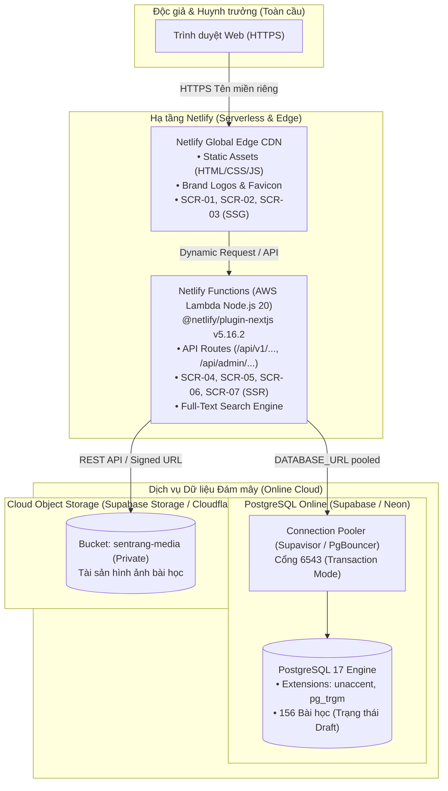
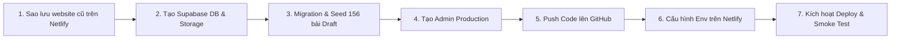

# KẾ HOẠCH TRIỂN KHAI THAY THẾ WEBSITE TRÊN NETLIFY (NETLIFY DEPLOYMENT PLAN)
## DỰ ÁN: TỦ SÁCH ÁO LAM V1.0
**Mã tài liệu:** `TUSAC-NETLIFY-PLAN-V1.0` | **Trạng thái:** Chờ phê duyệt  
**Ngày lập:** 12/10/2026 | **Phiên bản mã nguồn đóng gói:** Git Release Tag `v1.0.0`  
**Hạ tầng mục tiêu:** Netlify (Serverless + Global Edge CDN) + PostgreSQL Online + Cloud Object Storage  

---

## 1. TỔNG QUAN QUYẾT ĐỊNH & NGUYÊN TẮC THỰC HIỆN

Ban Điều Hành đã chính thức phê duyệt phương án:
1. **Tái sử dụng Netlify Site và tên miền hiện tại:** Thay thế hoàn toàn website thực hành cũ bằng **TỦ SÁCH ÁO LAM V1.0**.
2. **Chấp nhận gián đoạn tạm thời:** Website cũ không cần lưu giữ giao diện hay tính năng; việc thay thế diễn ra an toàn với phương án Rollback 1-click dự phòng.
3. **Bảo tồn toàn vẹn nhận diện & học liệu:** Tên thương hiệu **TỦ SÁCH ÁO LAM**, tagline *"Nơi tìm kiếm tài liệu tu học mới nhất"*, logo hoa sen trên quyển sách mở `#176B4A`, toàn bộ 6 màn hình công khai SCR-01 đến SCR-06 và khu vực Quản trị SCR-07.
4. **Bảo vệ dữ liệu nghiêm ngặt:** Toàn bộ **156 bài học** và 156 khối nội dung thô của Master Data V1.2 được nạp vào cơ sở dữ liệu ở trạng thái **`draft` (bản nháp nội bộ)**. Tuyệt đối **không tự động xuất bản** bất kỳ bài học nào lên Internet.
5. **An toàn bảo mật:** Không đẩy file `.env`, mật khẩu, tài khoản demo (`admin@sentrang.gdpt.vn`), file backup hay database dump lên GitHub.

---

## 2. ĐÁNH GIÁ TƯƠNG THÍCH KỸ THUẬT (COMPATIBILITY ASSESSMENT)

Triển khai Next.js 15 trên Netlify là mô hình **Serverless & Jamstack**, khác biệt đáng kể so với máy chủ VPS truyền thống. Dưới đây là phân tích chi tiết và các giải pháp đã được tích hợp sẵn vào mã nguồn:



### A. Tương thích Next.js 15 App Router trên Netlify
* **Hiện trạng:** Dự án sử dụng Next.js 15.1.7 (App Router, Server Actions, Server Components).
* **Khả năng tương thích:** **100% Tương thích**. Netlify đã phát hành chính thức `@netlify/plugin-nextjs` phiên bản `5.16.2` (Next.js Runtime V5), được thiết kế chuyên biệt cho Next.js 14 và 15.
* **Đã cấu hình sẵn trong mã nguồn:**
  - File cấu hình [`netlify.toml`](file:///a:/Web%20V2/netlify.toml) đã được tạo tại gốc dự án, kích hoạt plugin Next.js, thiết lập `NODE_VERSION = "20"`, nén Edge và bảo vệ các file nhạy cảm.
  - Script build trong [`package.json`](file:///a:/Web%20V2/package.json) đã được cập nhật thành: `"build": "prisma generate && next build"`.

### B. Tương thích Prisma & PostgreSQL trên môi trường Serverless (Serverless Connection Pooling)
* **Thách thức:** Trong môi trường Serverless của Netlify, mỗi yêu cầu có thể sinh ra một phiên bản Function riêng lẻ (stateless). Nếu kết nối trực tiếp đến PostgreSQL không qua bộ điều phối, số lượng kết nối sẽ nhanh chóng vượt quá giới hạn tối đa (`max_connections`).
* **Giải pháp bắt buộc:** Sử dụng **Connection Pooler** (Supavisor hoặc PgBouncer) ở chế độ **Transaction Mode**.
  - URL truy vấn thời gian thực (`DATABASE_URL`): Sử dụng cổng Connection Pooler (ví dụ: cổng `6543` trên Supabase với tham số `?pgbouncer=true`).
  - URL migration (`DIRECT_URL`): Sử dụng cổng kết nối trực tiếp (cổng `5432`) khi chạy lệnh `prisma migrate deploy` từ máy tính cục bộ.
* **Tương thích Extension tiếng Việt:** Cả Supabase và Neon đều hỗ trợ native 100% hai extension bắt buộc của dự án: `unaccent` và `pg_trgm`.

### C. Tương thích Hình ảnh & Media (Cloud Object Storage)
* **Thách thức cốt lõi:** Ổ đĩa trên Netlify Serverless là **bộ nhớ tạm (ephemeral) và chỉ đọc (read-only)**. Ảnh tải lên lưu trong thư mục `data/media` cục bộ sẽ **bị xóa sạch** sau khi Function kết thúc hoặc khi deploy phiên bản mới.
* **Giải pháp đã tích hợp vào Codebase:**
  - Đã xây dựng **Storage Adapter** đa năng trong [`src/lib/dal/admin/media.ts`](file:///a:/Web%20V2/src/lib/dal/admin/media.ts) và [`src/app/api/media/[filename]/route.ts`](file:///a:/Web%20V2/src/app/api/media/%5Bfilename%5D/route.ts).
  - Khi có biến môi trường `SUPABASE_URL` và `SUPABASE_SERVICE_ROLE_KEY`: Ảnh tải lên sẽ được chuyển tự động vào **Supabase Cloud Storage (Bucket riêng tư)** qua REST API native (không cần cài thêm thư viện nặng nề).
  - Vẫn giữ nguyên 100% cơ chế kiểm soát quyền: Ảnh của bài học chưa duyệt (`draft`) bắt buộc phải đăng nhập Admin mới xem được; khi thu hồi bài học (`unpublish`), hệ thống lập tức từ chối quyền truy cập ảnh và vô hiệu hóa cache.
  - Đã chuẩn bị script [`scripts/sync-media-to-cloud.ts`](file:///a:/Web%20V2/scripts/sync-media-to-cloud.ts) để đồng bộ 10 tệp ảnh tài sản ban đầu lên Cloud Storage chỉ bằng 1 câu lệnh.

---

## 3. BẢNG SO SÁNH GIẢI PHÁP HẠ TẦNG & DỰ TOÁN CHI PHÍ (ZERO-COST FOCUS)

Vì Bạn đã có sẵn Netlify và Tên miền, mục tiêu là **tối ưu chi phí phát sinh về mức 0 VNĐ** mà vẫn đảm bảo tính ổn định và bảo mật:

| Dịch vụ hạ tầng | Nhà cung cấp đề xuất | Gói dịch vụ & Thông số | Chi phí ước tính | Đánh giá & Khuyến nghị |
| :--- | :--- | :--- | :---: | :--- |
| **Hosting & CDN** | **Netlify** *(Tài khoản hiện có)* | Free Tier:<br/>• 100 GB Băng thông / tháng<br/>• 300 Phút Build / tháng<br/>• Tự động cấp phát HTTPS (SSL) | **0 VNĐ** | **Tối ưu**: Tái sử dụng Site và tên miền hiện tại, không phát sinh chi phí. |
| **PostgreSQL Database** | **Supabase** *(Đề xuất số 1)* | Free Tier:<br/>• 500 MB Database PostgreSQL 17<br/>• Hỗ trợ `unaccent` & `pg_trgm`<br/>• Tích hợp sẵn Supavisor Connection Pooler | **0 VNĐ** | **⭐ KHUYẾN NGHỊ SỐ 1**: Ổn định, tương thích hoàn hảo với Serverless, miễn phí vĩnh viễn trong hạn mức. |
| **Cloud Object Storage** | **Supabase Storage** *(Cùng dự án Supabase)* | Free Tier:<br/>• 1 GB Lưu trữ hình ảnh<br/>• 2 GB Băng thông tải ảnh / tháng | **0 VNĐ** | Quản lý tập trung trong cùng 1 Dashboard với Database, không cần tạo tài khoản dịch vụ khác. |
| **Giải pháp Dự phòng** | **Neon.tech** (DB) + **Cloudflare R2** (Storage) | Free Tier:<br/>• Neon: 0.5 GiB DB + Pooler<br/>• R2: 10 GB Storage, 0 VNĐ phí băng thông | **0 VNĐ** | Phương án thay thế nếu không sử dụng Supabase. |

> [!NOTE]
> **KẾT LUẬN CHI PHÍ:** **Tổng chi phí phát sinh là 0 VNĐ**. Dự án vận hành hoàn toàn trong khuôn khổ tài nguyên miễn phí chính thống của các nền tảng đám mây uy tín toàn cầu.

---

## 4. QUY TRÌNH SAO LƯU WEBSITE CŨ & PHƯƠNG ÁN ROLLBACK

Để đảm bảo an toàn tuyệt đối cho website thực hành cũ đang chạy trên Netlify:

### A. Quy trình Sao lưu Cấu hình Website Cũ (Pre-Replacement Backup)
1. **Ghi nhận cấu hình Netlify Site cũ:**
   * Tên Netlify Site Name (ví dụ: `your-site-name.netlify.app`).
   * GitHub Repository đang liên kết hiện tại (Tên Repo & Nhánh deploy).
   * Danh sách biến môi trường cũ tại: **Site configuration $\rightarrow$ Environment variables**.
2. **Tải về bản build deploy hiện tại của website cũ:**
   * Trên Netlify Dashboard $\rightarrow$ Chọn mục **Deploys**.
   * Nhấp vào bản deploy thành công gần nhất đang xuất bản (**Published deploy**).
   * Nhấp vào biểu tượng dấu ba chấm hoặc liên kết **"Download deploy"** để tải tệp nén `.zip` chứa toàn bộ website cũ về máy tính cá nhân lưu trữ.

### B. Phương án Rollback Đơn giản (1-Click Instant Rollback)
Nếu sau khi triển khai phiên bản mới mà Ban Điều Hành muốn khôi phục lại website cũ:
* **Cách 1 (Rollback tức thì trên Netlify — Mất 1 giây):**
  1. Truy cập Netlify Dashboard $\rightarrow$ Mục **Deploys**.
  2. Tìm bản deploy cũ đã lưu trước thời điểm triển khai.
  3. Nhấn vào bản deploy đó và chọn **"Publish deploy"**.
  4. *Kết quả:* Website cũ sẽ lập tức được khôi phục trực tuyến ngay lập tức mà không cần build lại mã nguồn.
* **Cách 2 (Khôi phục liên kết Git):**
  1. Vào **Site configuration** $\rightarrow$ **Build & deploy** $\rightarrow$ **Continuous deployment**.
  2. Chọn **Link to a different repository** và chọn lại Repo cũ.

---

## 5. QUY TRÌNH TRIỂN KHAI THAY THẾ CHUẨN 7 BƯỚC



### Bước 1: Sao lưu Website Cũ
Thực hiện tải bản deploy zip của website cũ trên Netlify Dashboard như hướng dẫn ở Mục 4A.

### Bước 2: Tạo Cơ Sở Dữ Liệu PostgreSQL Online (Supabase)
1. Đăng ký/Đăng nhập tài khoản miễn phí tại [supabase.com](https://supabase.com).
2. Tạo New Project: Đặt tên dự án (ví dụ: `tu-sach-ao-lam`), chọn khu vực máy chủ **Singapore** (gần Việt Nam nhất, ping $< 30$ms), đặt mật khẩu cơ sở dữ liệu mạnh.
3. Kích hoạt Extension tìm kiếm trong **SQL Editor**:
   ```sql
   CREATE EXTENSION IF NOT EXISTS unaccent;
   CREATE EXTENSION IF NOT EXISTS pg_trgm;
   ```
4. Lấy 2 chuỗi kết nối tại mục **Project Settings $\rightarrow$ Database**:
   * **Connection Pooling URL (Session/Transaction mode - Cổng 6543):** Dùng làm `DATABASE_URL` cho Netlify.
   * **Direct Connection URL (Cổng 5432):** Dùng để chạy migration từ máy tính.
5. Tạo Storage Bucket: Vào mục **Storage** $\rightarrow$ **Create bucket** $\rightarrow$ Đặt tên `sentrang-media` $\rightarrow$ Đặt chế độ **Private**.
6. Lấy API Keys tại **Project Settings $\rightarrow$ API**:
   * `Project URL` (tương ứng `SUPABASE_URL`)
   * `service_role secret` (tương ứng `SUPABASE_SERVICE_ROLE_KEY`)

### Bước 3: Nạp Schema, Migration & Master Data V1.2 từ Máy tính Cục bộ
Chạy các lệnh an toàn từ thư mục dự án `a:\Web V2` hướng đến database online:
```bash
# 1. Đẩy schema lên database online (sử dụng direct connection URL cổng 5432)
pnpm prisma migrate deploy

# 2. Nạp Master Data V1.2 (156 bài học ở trạng thái draft)
pnpm exec tsx prisma/seed.ts

# 3. Đồng bộ 10 tệp hình ảnh ban đầu lên Supabase Cloud Storage
pnpm exec tsx scripts/sync-media-to-cloud.ts
```
*Kết quả:* Toàn bộ dữ liệu giáo trình chuẩn được thiết lập hoàn chỉnh, 156 bài học đều ở trạng thái `draft`, không có bài nào bị công khai ngoài ý muốn.

### Bước 4: Khởi Tạo Tài Khoản Quản Trị Viên Production An Toàn
Khởi tạo tài khoản quản trị viên thực tế cho Ban Điều Hành:
```bash
pnpm exec tsx scripts/create-prod-admin.ts --email <EMAIL_QUAN_TRI_THUC> --password <MAT_KHAU_MANH>
```
* Không sử dụng tài khoản hay mật khẩu demo. Mật khẩu được băm bằng bcrypt cost 12 và ghi nhận nhật ký kiểm toán.

### Bước 5: Đẩy Mã Nguồn TỦ SÁCH ÁO LAM lên GitHub
1. Trên GitHub của Bạn: Sử dụng repository hiện tại đang liên kết với Netlify (hoặc tạo repository mới nếu muốn tách biệt hoàn toàn).
2. Thêm remote và đẩy nhánh `main`:
   ```bash
   git remote add origin https://github.com/<YOUR_USERNAME>/<YOUR_REPO>.git
   git push -u origin main --force
   ```
   *(Nhờ file `.gitignore` chặt chẽ, các file `.env`, mật khẩu, database nội bộ, demo credentials tuyệt đối không bị đưa lên GitHub)*.

### Bước 6: Thiết Lập Biến Môi Trường trên Netlify Dashboard
Truy cập Netlify Dashboard $\rightarrow$ Chọn Site của Bạn $\rightarrow$ **Site configuration** $\rightarrow$ **Environment variables**, thêm các biến sau:

| Tên biến môi trường | Giá trị cấu hình | Ý nghĩa & Bảo mật |
| :--- | :--- | :--- |
| `NODE_VERSION` | `20` | Chỉ định phiên bản Node.js 20 LTS cho Netlify Functions |
| `NODE_ENV` | `production` | Bật chế độ tối ưu production của Next.js |
| `APP_ENV` | `production` | Kích hoạt cơ chế Fail-Fast chặn kết nối database test |
| `DATABASE_URL` | *Chuỗi Pooled URL từ Supabase (Cổng 6543)* | Kết nối PostgreSQL qua Supavisor Connection Pooler |
| `AUTH_SECRET` | *Chuỗi 64 ký tự hex sinh bởi `openssl rand -hex 32`* | Khóa ký số JWT bảo vệ phiên đăng nhập Quản trị |
| `NEXT_PUBLIC_APP_URL` | *Tên miền chính thức của Bạn (https://...)* | URL chuẩn hóa cho SEO, Open Graph và Cookie |
| `SUPABASE_URL` | *Project URL của Supabase* | Đường dẫn gọi Cloud Storage API |
| `SUPABASE_SERVICE_ROLE_KEY` | *Secret Key của Supabase* | Khóa dịch vụ xác thực tải và đọc tệp ảnh |
| `SUPABASE_STORAGE_BUCKET` | `sentrang-media` | Tên Bucket lưu trữ ảnh |

### Bước 7: Kích Hoạt Triển Khai & Kiểm Thử Khói (Production Smoke Test)
1. Trên Netlify: Nhấn **"Trigger deploy"** $\rightarrow$ **"Deploy site"**.
2. Netlify sẽ tự động tải dependencies, sinh Prisma Client, build Next.js 15 và phân phối ra toàn cầu qua Edge CDN.
3. Tiến hành kiểm thử khói trên tên miền chính thức:
   * **Trang chủ `/`:** Hiển thị đúng nhận diện thương hiệu TỦ SÁCH ÁO LAM, logo hoa sen kết hợp sách mở `#176B4A`, tagline.
   * **Bảo vệ dữ liệu nháp:** Các trang bài học draft đều trả về 404 nếu truy cập trực tiếp; tìm kiếm trả về 0 kết quả (vì chưa xuất bản).
   * **Quản trị `/admin/login`:** Đăng nhập thành công với tài khoản quản trị mới; từ chối tài khoản demo; danh sách học liệu hiển thị đủ 156 bài học ở trạng thái `draft`.

---

## 6. DANH MỤC THAO TÁC CẦN BAN ĐIỀU HÀNH THỰC HIỆN

Để tiến hành theo kế hoạch trên, Bạn chỉ cần thực hiện các thao tác đơn giản sau:

### 1. Thao tác trên GitHub:
* Xác nhận tên tài khoản GitHub và tên Repository đang kết nối với Netlify Site hiện tại.
* Cho phép cấp quyền push mã nguồn TỦ SÁCH ÁO LAM V1.0 lên repository đó (hoặc tạo một repository mới trên GitHub và liên kết lại trong Netlify).

### 2. Thao tác trên Dịch vụ Database (Supabase - Miễn phí):
* Truy cập [supabase.com](https://supabase.com), đăng ký tài khoản miễn phí bằng tài khoản GitHub có sẵn.
* Tạo 1 Project mới mang tên `tu-sach-ao-lam` (vùng Singapore).
* Cung cấp cho tôi chuỗi kết nối Database (`Connection string` dạng URI) và API keys (`SUPABASE_URL`, `SUPABASE_SERVICE_ROLE_KEY`).

### 3. Thao tác trên Netlify:
* Đăng nhập Netlify, tải bản backup zip của website cũ (theo hướng dẫn ở Mục 4A).
* Nhập các biến môi trường vào mục **Environment variables** (theo bảng ở Bước 6).

---

> [!IMPORTANT]
> **Cam kết:** Tôi **chưa thực hiện bất kỳ lệnh push hay deploy nào** lên GitHub hoặc Netlify. Mọi thao tác chỉ được tiến hành sau khi Bạn xem xét và phê duyệt kế hoạch này!
