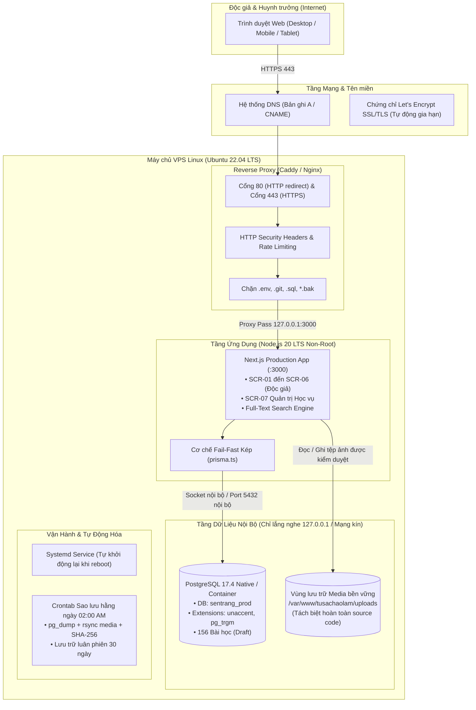

# KẾ HOẠCH TRIỂN KHAI HỆ THỐNG LÊN INTERNET (PRODUCTION DEPLOYMENT PLAN)
## DỰ ÁN: TỦ SÁCH ÁO LAM V1.0
**Mã tài liệu:** `TUSAC-DEP-PLAN-V1.0` | **Trạng thái:** Chờ phê duyệt hạ tầng  
**Ngày lập:** 12/10/2026 | **Phiên bản mã nguồn đóng gói:** Git Release Tag `v1.0.0`  
**Gói sao lưu cơ sở (Pre-deployment Backup):** `bundle_sentrang_20261012_041958` (SHA-256: `e122e0a461c78...`)

---

## 1. TỔNG QUAN VÀ MỤC TIÊU TRIỂN KHAI

Kế hoạch này thiết lập quy trình chuẩn hóa nhằm đưa website **TỦ SÁCH ÁO LAM** — Nền tảng tra cứu học liệu tu học Ngành Đồng (Gia Đình Phật Tử Việt Nam) — từ môi trường thử nghiệm nội bộ lên mạng Internet công khai trên nền tảng máy chủ ảo riêng (VPS).

### Nguyên tắc bất biến (Non-Negotiable Constraints):
1. **Bảo toàn nhận diện thương hiệu đã nghiệm thu:** Giữ nguyên tên **TỦ SÁCH ÁO LAM**, khẩu hiệu *"Nơi tìm kiếm tài liệu tu học mới nhất"*, biểu tượng hoa sen trắng trên quyển sách mở nền xanh lục đậm `#176B4A`, cùng toàn bộ giao diện SCR-01 đến SCR-07.
2. **Không tự động xuất bản học liệu:** 156 bài học của Master Data V1.2 được nạp vào cơ sở dữ liệu production ở trạng thái **`draft` (bản nháp nội bộ)**. Quyền xuất bản công khai thuộc về Ban Điều Hành và Ban Biên Tập sau khi hoàn tất kiểm định nội dung từng bài qua giao diện Quản trị.
3. **Tuyệt đối không dùng dữ liệu và tài khoản demo:** Cô lập hoàn toàn cơ sở dữ liệu thử nghiệm `sentrang_test`; không mang bất kỳ tài khoản demo (`demo.admin@...`, `admin@sentrang.gdpt.vn`) hay mật khẩu mặc định nào lên Production.
4. **Không mua dịch vụ hoặc đưa website lên Internet khi chưa có xác nhận hạ tầng:** Dừng lại ở bước lập kế hoạch và đóng gói công cụ, chờ Ban Điều Hành cung cấp IP VPS, thông tin DNS tên miền và phê duyệt chi phí.

---

## 2. KIẾN TRÚC HỆ THỐNG PRODUCTION (TARGET ARCHITECTURE)

Hệ thống được thiết kế theo mô hình 3 tầng (3-Tier Isolated Architecture) bảo đảm hiệu năng cao, chi phí tối ưu và an toàn dữ liệu:



### Điểm nhấn kiến trúc:
* **Cô lập cơ sở dữ liệu:** Cổng 5432 của PostgreSQL **không mở ra Internet** (chỉ bind `127.0.0.1` hoặc mạng nội bộ Docker), tường lửa UFW chặn toàn bộ kết nối bên ngoài vào cơ sở dữ liệu.
* **Tách biệt vùng lưu trữ Media:** Thư mục ảnh `/var/www/tusachaolam/uploads` (hoặc Docker volume `tusach_media_data`) nằm hoàn toàn ngoài thư mục mã nguồn Git. Khi cập nhật ứng dụng (`git pull`, `docker build`), tài sản ảnh không bao giờ bị mất mát hay ghi đè.
* **Reverse Proxy chuyên dụng:** Caddy hoặc Nginx đóng vai trò tuyến phòng thủ đầu tiên: xử lý chứng chỉ SSL tự động, nén Gzip/Zstandard, cấu hình HTTP Security Headers và chặn đứng mọi truy vấn vào file nhạy cảm.

---

## 3. CẤU HÌNH VPS ĐỀ XUẤT & BẢNG DỰ TOÁN CHI PHÍ

Dựa trên quy mô học liệu (156 bài học, ~200 ảnh tài sản) và lưu lượng dự kiến phục vụ tổ chức GĐPT trên toàn quốc:

### A. Tiêu chuẩn phần cứng máy chủ VPS (Hardware Sizing)

| Thành phần | Cấu hình Tối thiểu (Minimum) | Cấu hình Khuyến nghị (Recommended) | Mục đích đáp ứng |
| :--- | :--- | :--- | :--- |
| **CPU** | 2 vCPU | **2 vCPU (High-Performance)** | Xử lý Next.js Server Components & tìm kiếm unaccent Trigram |
| **RAM** | 2 GB (+ 2GB Swap) | **4 GB RAM** | Bộ đệm PostgreSQL buffer, cache Node.js, thao tác build mượt mà |
| **Ổ cứng (Storage)** | 30 GB SSD | **50 GB SSD NVMe** | Hệ điều hành (10GB), Ứng dụng & Media (10GB), Lưu trữ bản sao lưu 30 ngày (30GB) |
| **Băng thông (Bandwidth)** | 100 Mbps Shared | **200 Mbps - 1 Gbps Unlimited** | Tốc độ tải trang nhanh, không nghẽn mạng khi đọc bài kèm hình ảnh |
| **Hệ điều hành (OS)** | Ubuntu 22.04 LTS 64-bit | **Ubuntu 22.04 LTS 64-bit** | Tính ổn định cao, tương thích tốt nhất với Node.js 20 LTS & PostgreSQL 17 |

---

### B. So sánh Nhà cung cấp Hạ tầng & Dự toán chi phí thực tế

> [!NOTE]
> Hệ thống web phục vụ độc giả chính tại Việt Nam, do đó khuyến nghị ưu tiên các nhà cung cấp có Data Center tại TP. Hồ Chí Minh hoặc Hà Nội để đạt độ trễ mạng thấp nhất (< 15ms).

| Đơn vị cung cấp | Gói dịch vụ đề xuất | Thông số kỹ thuật | Chi phí ước tính (VNĐ / Tháng) | Chi phí tương đương (USD) | Đánh giá & Khuyến nghị |
| :--- | :--- | :--- | :--- | :--- | :--- |
| **Vietnix** *(Việt Nam)* | Cloud Server Pro 2 | 2 vCPU, 4GB RAM, 50GB NVMe | **~ 290.000 VNĐ** | ~ \$11.5 / tháng | **⭐ KHUYẾN NGHỊ SỐ 1**: Tốc độ trong nước cực nhanh, chống DDoS tốt, hỗ trợ tiếng Việt 24/7. |
| **BKNS / AZDIGI** *(Việt Nam)* | KVM VPS Pro | 2 vCPU, 4GB RAM, 45GB NVMe | **~ 260.000 – 320.000 VNĐ** | ~ \$10.5 – \$13 / tháng | Hạ tầng Viettel/VNPT IDC, hỗ trợ kỹ thuật nhanh. |
| **Viettel IDC** *(Việt Nam)* | Cloud Server Standard | 2 vCPU, 4GB RAM, 50GB SSD | **~ 350.000 VNĐ** | ~ \$14 / tháng | Độ ổn định doanh nghiệp cao, đường truyền chuẩn Tier 3. |
| **Hetzner Cloud** *(Quốc tế)* | Gói CX22 / CPX21 | 3 vCPU AMD, 4GB RAM, 40GB NVMe | **~ 135.000 – 190.000 VNĐ** *(€5 – €7)* | ~ \$5.5 – \$7.5 / tháng | Chi phí rẻ nhất, hiệu năng phần cứng rất mạnh; tuy nhiên máy chủ ở Châu Âu/Mỹ (cần thêm Cloudflare CDN nếu phục vụ độc giả VN). |
| **DigitalOcean** *(Quốc tế)* | Basic Droplet (Singapore) | 2 vCPU, 4GB RAM, 80GB SSD | **~ 600.000 VNĐ** | \$24 / tháng | Datacenter Singapore, ổn định nhưng giá thành cao hơn nhà mạng trong nước. |

---

### C. Dự toán Chi phí Tên miền (Domain Name)

| Loại tên miền | Đơn vị đăng ký | Chi phí năm đầu | Chi phí duy trì hằng năm | Ghi chú |
| :--- | :--- | :--- | :--- | :--- |
| **Tên miền quốc gia `.vn`**<br/>*(ví dụ: `tusachaolam.vn`)* | PA Việt Nam, Mắt Bão, INET | ~ 550.000 VNĐ | ~ 450.000 VNĐ/năm | **Khuyến nghị**: Uy tín cao, định danh chính thống cho dự án Phật giáo tại Việt Nam. |
| **Tên miền quốc tế `.com` / `.org`**<br/>*(ví dụ: `tusachaolam.org`)* | Cloudflare, Namecheap, Mắt Bão | ~ 250.000 – 320.000 VNĐ | ~ 320.000 VNĐ/năm | Phương án tiết kiệm, thủ tục kích hoạt tức thì. |
| **Chứng chỉ SSL/TLS (HTTPS)** | Let's Encrypt / Caddy | **0 VNĐ (Miễn phí)** | **0 VNĐ** | Tự động cấp phát và tự động gia hạn 90 ngày/lần. |

> [!TIP]
> **Tổng ngân sách vận hành ước tính:** Chỉ từ **~ 300.000 – 350.000 VNĐ/tháng** (chưa bao gồm phí duy trì tên miền hằng năm).

---

## 4. QUY TRÌNH TRIỂN KHAI 8 BƯỚC CHUẨN XÁC (DEPLOYMENT WORKFLOW)

```mermaid
flowchart LR
    S1["1. Chuẩn bị VPS & Bảo mật OS"] --> S2["2. Thiết lập Môi trường & Database"]
    S2 --> S3["3. Cấu hình .env Production"]
    S3 --> S4["4. Migration & Seed Master Data"]
    S4 --> S5["5. Khởi tạo Admin Production"]
    S5 --> S6["6. Khởi chạy Dịch vụ & Nginx/Caddy"]
    S6 --> S7["7. Trỏ DNS & Kích hoạt HTTPS"]
    S7 --> S8["8. Smoke Test & Bàn giao Vận hành"]
```



### Bước 1: Khởi tạo VPS & Bảo mật Hệ điều hành
1. Đăng nhập VPS bằng SSH key (vô hiệu hóa đăng nhập root qua mật khẩu thường):
   ```bash
   sudo apt update && sudo apt upgrade -y
   sudo apt install -y ufw curl wget git rsync unattended-upgrades
   ```
2. Cấu hình tường lửa UFW chỉ cho phép các cổng cần thiết:
   ```bash
   sudo ufw default deny incoming
   sudo ufw default allow outgoing
   sudo ufw allow 22/tcp    # Cổng SSH (hoặc cổng SSH tùy chỉnh)
   sudo ufw allow 80/tcp    # Cổng HTTP
   sudo ufw allow 443/tcp   # Cổng HTTPS
   sudo ufw enable
   ```
   *(Cổng 5432 và 3000 bị chặn tuyệt đối từ bên ngoài)*.

### Bước 2: Thiết lập Môi trường Chạy (Chọn Phương án A hoặc B)
* **Phương án A (Khuyến nghị — Docker Compose):**
  Cài đặt Docker Engine & Docker Compose Plugin:
  ```bash
  curl -fsSL https://get.docker.com -o get-docker.sh && sudo sh get-docker.sh
  sudo usermod -aG docker $USER
  ```
* **Phương án B (Native Linux):**
  Cài đặt Node.js 20 LTS, pnpm và PostgreSQL 17 trực tiếp trên máy chủ.

### Bước 3: Đưa Mã nguồn lên VPS & Cấu hình Biến Môi Trường
1. Clone mã nguồn từ bản release đã nghiệm thu:
   ```bash
   git clone --branch v1.0.0 <REPO_URL> /var/www/tusachaolam
   cd /var/www/tusachaolam
   ```
2. Tạo tệp `.env` bảo mật từ tệp mẫu [`/.env.production.example`](file:///a:/Web%20V2/.env.production.example):
   ```bash
   cp .env.production.example .env
   ```
3. Sinh khóa xác thực ngẫu nhiên 64 ký tự hex:
   ```bash
   openssl rand -hex 32
   ```
   Điền vào trường `AUTH_SECRET="..."` trong `.env`.
4. Thiết lập mật khẩu cơ sở dữ liệu mạnh riêng biệt cho `DATABASE_URL` (tuyệt đối không dùng chữ `sentrang_test`).

### Bước 4: Chạy Migration & Nạp Master Data V1.2 (Idempotent)
1. Áp dụng schema và migration:
   ```bash
   pnpm prisma migrate deploy
   ```
2. Kích hoạt extension tiếng Việt `unaccent` và `pg_trgm`:
   ```bash
   psql -U tusach_admin -d sentrang_prod -f prisma/search_indexes.sql
   ```
3. Nạp Master Data V1.2 qua lệnh:
   ```bash
   pnpm exec tsx prisma/seed.ts
   ```
   *Kết quả:* Nạp đủ 1 ngành, 4 bậc, 3 lĩnh vực, 4 nguồn giáo trình, **156 bài học ở trạng thái `draft` (bản nháp)** và 156 khối nội dung thô. **0 bài nào bị tự động xuất bản**.

### Bước 5: Khởi tạo Tài khoản Quản trị viên Production An toàn
Sử dụng script nội bộ chuyên dụng [`/scripts/create-prod-admin.ts`](file:///a:/Web%20V2/scripts/create-prod-admin.ts):
```bash
pnpm exec tsx scripts/create-prod-admin.ts --email <EMAIL_QUAN_TRI_THUC> --password <MAT_KHAU_MANH>
```
* **Quy chuẩn bắt buộc:** Mật khẩu tối thiểu 12 ký tự, có chữ hoa, chữ thường, chữ số, ký tự đặc biệt.
* **Cấm tiệt:** Không chấp nhận mật khẩu demo `SenTrang@Admin2026!` hay email demo `admin@sentrang.gdpt.vn`.
* **Ghi nhận kiểm toán:** Sự kiện `ADMIN_ACCOUNT_INITIALIZED` được tự động ghi vào bảng `audit_logs`.

### Bước 6: Khởi chạy Dịch vụ & Cấu hình Tự phục hồi
* **Với Docker Compose:**
  ```bash
  docker compose -f docker-compose.prod.yml up -d --build
  ```
* **Với Native Systemd & Nginx:**
  ```bash
  sudo cp deploy/systemd/tusachaolam.service /etc/systemd/system/
  sudo systemctl daemon-reload
  sudo systemctl enable --now tusachaolam
  sudo cp deploy/nginx/tusachaolam.conf /etc/nginx/sites-available/
  sudo ln -s /etc/nginx/sites-available/tusachaolam.conf /etc/nginx/sites-enabled/
  sudo nginx -t && sudo systemctl reload nginx
  ```

### Bước 7: Trỏ DNS Tên Miền & Kích hoạt HTTPS
1. Truy cập trang quản trị DNS của nhà cung cấp tên miền:
   * **Bản ghi A:** `@` trỏ về `IP_VPS`
   * **Bản ghi CNAME:** `www` trỏ về `tenmiencuaban.vn`
2. Sau khi DNS lan truyền (5–15 phút), Caddy hoặc Certbot tự động cấp phát chứng chỉ SSL Let's Encrypt hợp lệ.

### Bước 8: Kiểm thử Khói (Production Smoke Test) & Bàn giao
Thực hiện kịch bản kiểm thử trực tiếp trên tên miền chính thức:
* Trang chủ `/`: Hiển thị logo, thương hiệu TỦ SÁCH ÁO LAM, tagline, 4 bậc học.
* Tìm kiếm `/tim-kiem`: Hoạt động bình thường, trả về 0 kết quả nếu chưa bài nào published (bảo vệ draft).
* Đăng nhập Admin `/admin/login`: Đăng nhập thành công với tài khoản production mới khởi tạo; từ chối tài khoản demo.
* Vùng biên tập `/admin/lessons`: Thấy đủ 156 bài học ở trạng thái `draft`.

---

## 5. KẾ HOẠCH SAO LƯU & PHỤC HỒI THẢM HỌA (DISASTER RECOVERY)

### A. Sao lưu Tự động Hằng ngày (Automated Backup)
Thiết lập cronjob chạy vào lúc 02:00 sáng mỗi ngày bằng script [`/deploy/scripts/backup-cron.sh`](file:///a:/Web%20V2/deploy/scripts/backup-cron.sh):
```cron
0 2 * * * /var/www/tusachaolam/deploy/scripts/backup-cron.sh >> /var/log/tusach_backup.log 2>&1
```
* **Cơ chế:**
  1. Trích xuất cơ sở dữ liệu `sentrang_prod` bằng `pg_dump` với cờ `--clean --if-exists`.
  2. Đồng bộ thư mục ảnh `/var/www/tusachaolam/uploads` qua `rsync`.
  3. Kê khai mã băm SHA-256 vào tệp `manifest.json`.
  4. Đóng gói nén thành tệp `tusach_backup_YYYYMMDD_HHMMSS.tar.gz`.
  5. Tự động xóa các bản sao lưu cũ hơn **30 ngày** (Retention policy).

### B. Quy trình Phục hồi Khẩn cấp (Disaster Recovery)
Khi xảy ra sự cố phần cứng, lỗi dữ liệu hoặc tấn công phá hoại, thực hiện lệnh phục hồi với script [`/deploy/scripts/restore-prod.sh`](file:///a:/Web%20V2/deploy/scripts/restore-prod.sh):
```bash
sudo ./deploy/scripts/restore-prod.sh /var/backups/tusachaolam/tusach_backup_YYYYMMDD_HHMMSS.tar.gz
```
* **Chỉ số cam kết:**
  * **RTO (Thời gian phục hồi dịch vụ):** $< 2$ phút.
  * **RPO (Dữ liệu mất mát tối đa):** Tối đa 24 giờ kể từ bản backup gần nhất.

---

## 6. KẾ HOẠCH HOÀN NGUYÊN KHẨN CẤP (ROLLBACK PLAN)

Trong tình huống phiên bản mới gặp sự cố nghiêm trọng sau khi triển khai:

| Tình huống sự cố | Quy trình Rollback | Thời gian thực hiện |
| :--- | :--- | :--- |
| **Lỗi ứng dụng Next.js (500 Error, Crash)** | Chuyển mã nguồn về Git tag trước đó (`git checkout v1.0.0`) và restart tiến trình, hoặc swap về Docker container image trước đó (`docker compose rollback`). | 1 phút |
| **Lỗi hỏng dữ liệu hoặc migration sai** | Tạm dừng tiến trình web, chạy script `restore-prod.sh` để nạp lại bản sao lưu database trước khi deploy. | 2–3 phút |
| **Lỗi chứng chỉ SSL hoặc Reverse Proxy** | Khôi phục file cấu hình `/etc/caddy/Caddyfile` hoặc `/etc/nginx/sites-available/tusachaolam.conf` từ bản backup và reload proxy. | 1 phút |

---

## 7. ĐẶC TẢ XỬ LÝ MEDIA CACHE KHI THU HỒI BÀI HỌC (CACHE REVOCATION)

Hệ thống bảo vệ hình ảnh nội bộ thông qua Route Handler [`src/app/api/media/[filename]/route.ts`](file:///a:/Web%20V2/src/app/api/media/%5Bfilename%5D/route.ts) với cơ chế kiểm soát động:

1. **Khi bài học được xuất bản công khai:**
   * Response trả về ảnh kèm header:
     ```http
     Cache-Control: public, max-age=1800, s-maxage=3600, must-revalidate
     ETag: "c2a5e4b..."
     ```
   * Trình duyệt hoặc CDN được phép cache tạm thời nhưng bắt buộc kiểm tra ETag (`must-revalidate`).
2. **Khi bài học bị thu hồi (Unpublish về Draft):**
   * Trường `publishStatus` của bài học trong PostgreSQL chuyển từ `'published'` sang `'draft'`.
   * Ở lần yêu cầu ảnh tiếp theo, hàm `prisma.lessonImage` truy vấn database thấy bài học không còn public.
   * Route Handler **ngay lập tức từ chối** độc giả vãng lai với mã HTTP `401 Unauthorized` và gắn kèm header:
     ```http
     Cache-Control: no-store, no-cache, must-revalidate, proxy-revalidate
     Pragma: no-cache
     ```
   * Trình duyệt và proxy ngay lập tức xóa cache và không bao giờ phục vụ ảnh đó nữa.

---

## 8. DANH MỤC THÔNG TIN CẦN BAN ĐIỀU HÀNH XÁC NHẬN TRƯỚC KHI THỰC HIỆN

Để bắt đầu tiến hành triển khai thực tế trên máy chủ, kính đề nghị Ban Điều Hành cung cấp các thông tin sau:

| STT | Hạng mục thông tin | Mô tả chi tiết | Trạng thái hiện tại |
| :---: | :--- | :--- | :---: |
| **1** | **Địa chỉ IP máy chủ VPS** | Địa chỉ Public IPv4 của máy chủ đã mua (ví dụ: `103.xxx.xxx.xxx`) | ⏳ *Chờ cung cấp* |
| **2** | **Thông tin truy cập SSH** | Cổng SSH (mặc định 22), tài khoản (root/ubuntu), SSH Key hoặc mật khẩu ban đầu | ⏳ *Chờ cung cấp* |
| **3** | **Tên miền chính thức** | Tên miền định danh cho website (ví dụ: `tusachaolam.vn` hoặc `tusachaolam.org`) | ⏳ *Chờ cung cấp* |
| **4** | **Quyền quản trị DNS** | Xác nhận đã có quyền tạo bản ghi A và CNAME trỏ về IP của VPS | ⏳ *Chờ cung cấp* |
| **5** | **Email nhận chứng chỉ SSL** | Email của quản trị viên dùng để đăng ký chứng chỉ Let's Encrypt (để nhận cảnh báo gia hạn) | ⏳ *Chờ cung cấp* |
| **6** | **Tài khoản Admin Production** | Email thực tế của quản trị viên đầu tiên (để chạy `create-prod-admin.ts`) | ⏳ *Chờ cung cấp* |

> [!CAUTION]
> **Cam kết:** Tôi **không tự ý mua dịch vụ**, **không đưa mật khẩu vào báo cáo**, và **không triển khai lên server công khai** cho đến khi các thông tin hạ tầng trên được Ban Điều Hành xác nhận và phê duyệt.
